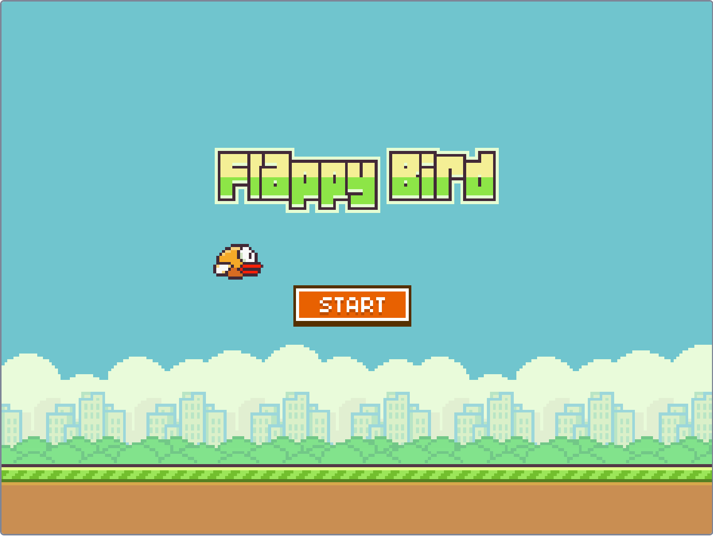
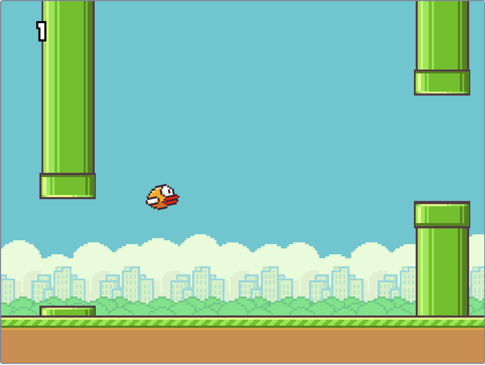
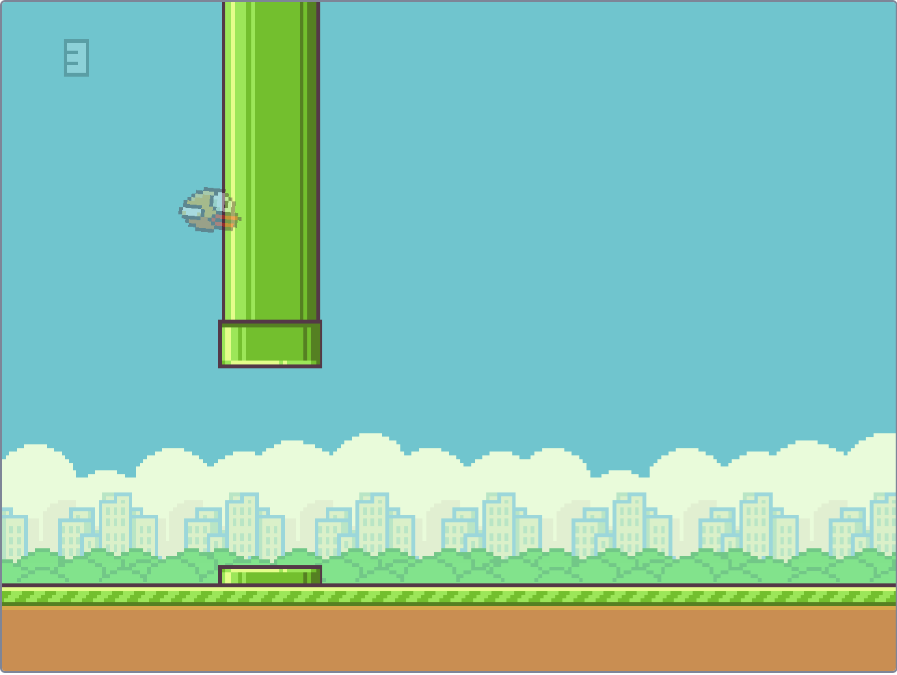

# Flappy Bird

> **Harvard CS50x – Week 0 (Scratch)**

Flappy Bird is one of the Scratch projects I developed while completing Harvard's CS50x Week 0. It recreates the classic gameplay while focusing on movement physics, obstacle generation, and collision detection.

## Overview

Flappy Bird is a Scratch recreation of the classic arcade game where the player guides a bird through a series of obstacles while trying to achieve the highest possible score.

This project focuses on implementing gravity, collision detection, continuous obstacle movement, and score tracking using Scratch.

---

## Gameplay

The objective is to fly through as many gaps between the pipes as possible without colliding with an obstacle or the ground.

The game becomes increasingly challenging as the player attempts to achieve a higher score.

### Start Screen

### Gameplay

### Collision

---

## Features

- Gravity-based movement
- Jump mechanics
- Obstacle generation
- Collision detection
- Score tracking
- Continuous gameplay

---

## Controls

| Key | Action |
|------|--------|
| Space | Flap / Jump |

---

## Concepts Practiced

- Event-driven programming
- Variables
- Loops
- Collision detection
- Animation
- Game logic

---

## Technologies

- Scratch 3

---

## Course Information

**Course:** Harvard CS50x – Introduction to Computer Science

**Week:** Week 0 – Scratch

---

## Author

**Faizan Siddique**

[Back to Week 0](../README.md) · [Back to repository](../../README.md)
