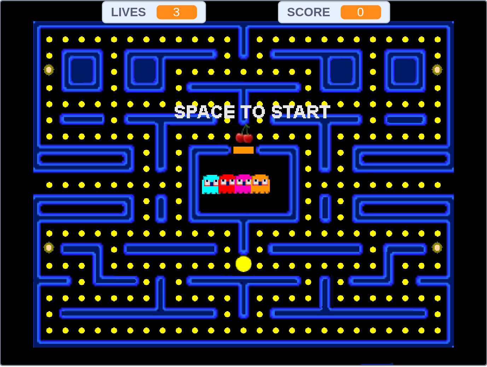
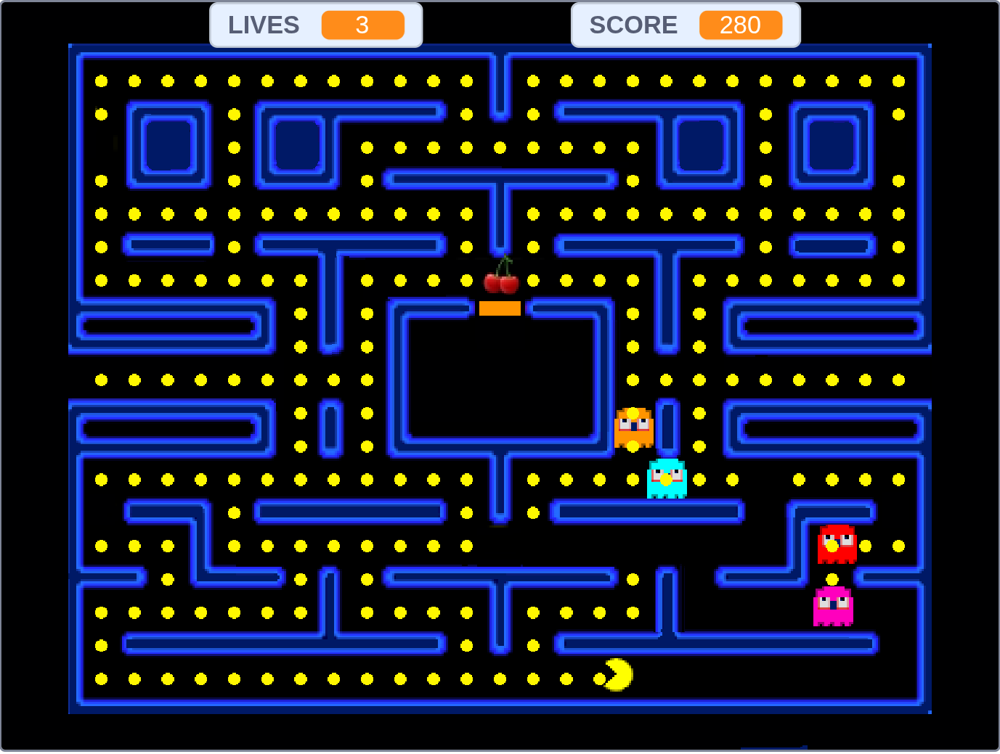
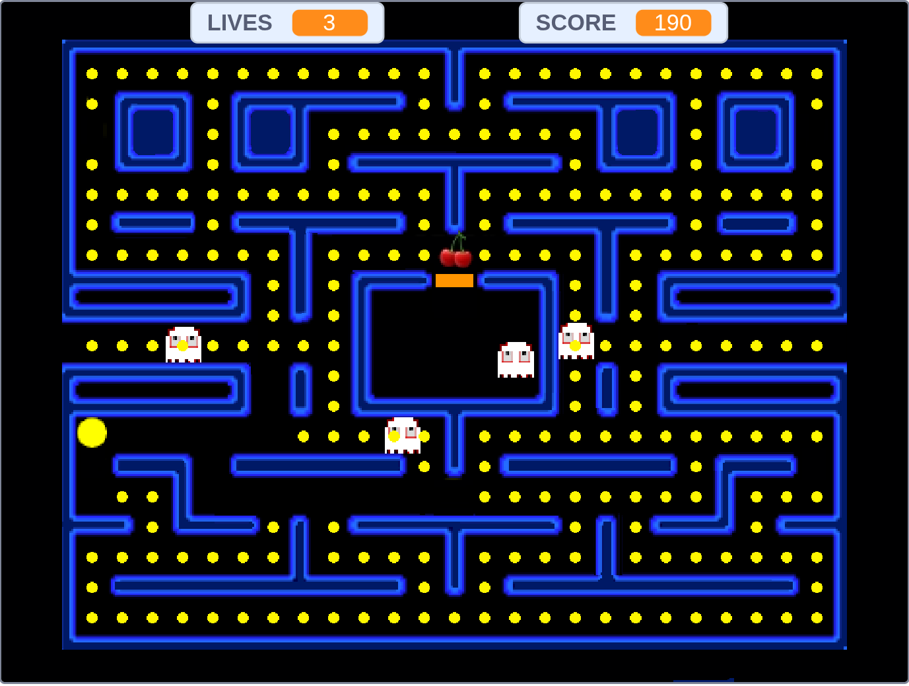
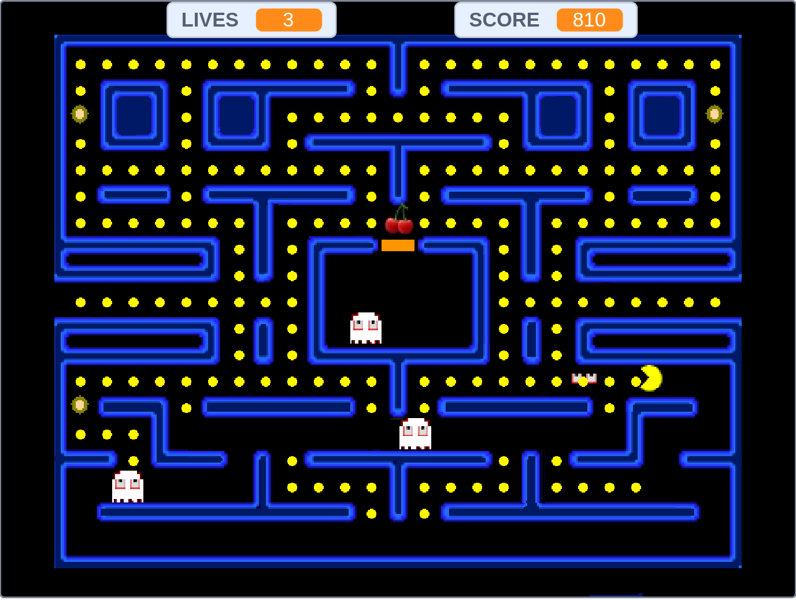
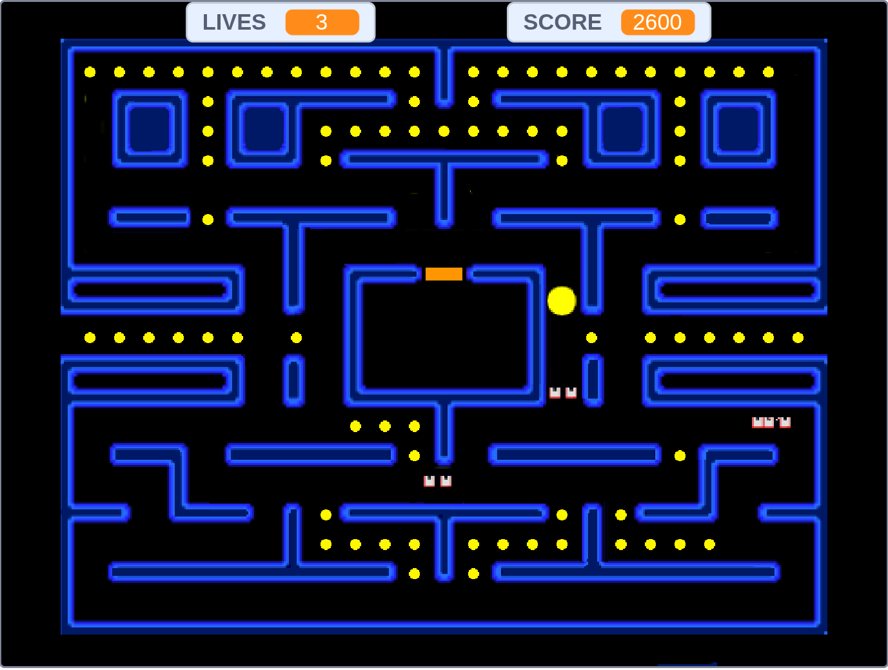
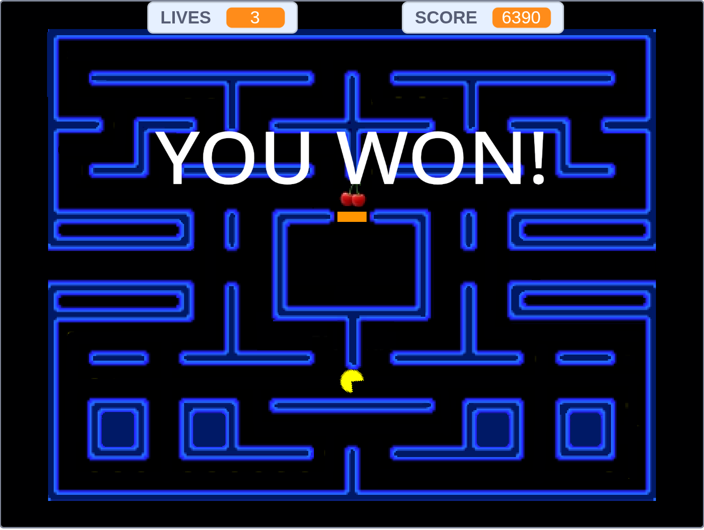

# AI Pac-Man

> **Harvard CS50x – Week 0 (Scratch)**

AI Pac-Man is my official submission for **Harvard's CS50x Week 0**. Inspired by the classic Pac-Man arcade game, this Scratch project expands upon the original gameplay by introducing AI-controlled ghosts, power pills, multiple levels, score tracking, lives, and a complete win condition.

Although Week 0 only requires a single Scratch project, I challenged myself to build a more feature-rich game that would strengthen my understanding of computational thinking, game design, and event-driven programming.

---

## Gameplay Preview

### Start Screen



### Exploring the Maze



### Blinking Power Pill



### Frightened Ghosts



### Ghost Captured



### Victory



---

## Overview

The objective is to collect every dot across two levels while avoiding AI-controlled ghosts. Collecting a power pill temporarily changes ghost behavior, allowing the player to chase and capture ghosts for bonus points before the effect expires.

The game combines multiple gameplay systems into a single interactive project, including enemy AI, collision detection, scoring, lives, power-ups, level progression, and victory conditions.

---

## Features

- AI-driven ghost system with three ghost clones
- Four blinking power pills
- Temporary frightened ghost mode
- Ghost capture for bonus points
- Score tracking
- Lives system
- Two playable levels
- Win and game-over conditions

---

## Controls

| Key | Action |
|------|--------|
| ↑ ↓ ← → | Move Pac-Man |

---

## How It Works

The player navigates the maze to collect dots while avoiding ghosts. Every collected dot increases the score. Collecting a blinking power pill temporarily puts the ghosts into frightened mode for ten seconds, allowing Pac-Man to capture them for additional points. Once the timer expires, the ghosts return to their normal chasing behavior. The game ends when all dots across both levels are collected or when the player loses all lives.

---

## Challenges & Solutions

One of the most interesting challenges was designing an AI-driven ghost mechanism and coordinating multiple ghost clones so they consistently pursued the player throughout the game. Another challenge was implementing the temporary power-pill mechanic, which required dynamically changing ghost behavior for ten seconds before seamlessly restoring their normal chasing behavior.

---

## What I Learned

Through this project, I strengthened my understanding of:

- Computational thinking
- Event-driven programming
- Variables and game state management
- Collision detection
- Broadcast messages
- Cloning
- Debugging interactive applications
- Designing complete game mechanics

---

## Repository Structure

```text
pac-man/
├── README.md
└── screenshots/
    ├── 01-start-screen.png
    ├── 02-gameplay.png
    ├── 03-blinking-power-pill.png
    ├── 04-frightened-ghosts.png
    ├── 05-ghost-captured.png
    └── 06-victory-screen.png
```

---

## Course Information

- **Course:** Harvard CS50x – Introduction to Computer Science
- **Week:** 0 – Scratch
- **Platform:** Scratch 3

---

## Author

**Faizan Siddique**

[Back to Week 0](../README.md) · [Back to repository](../../README.md)
