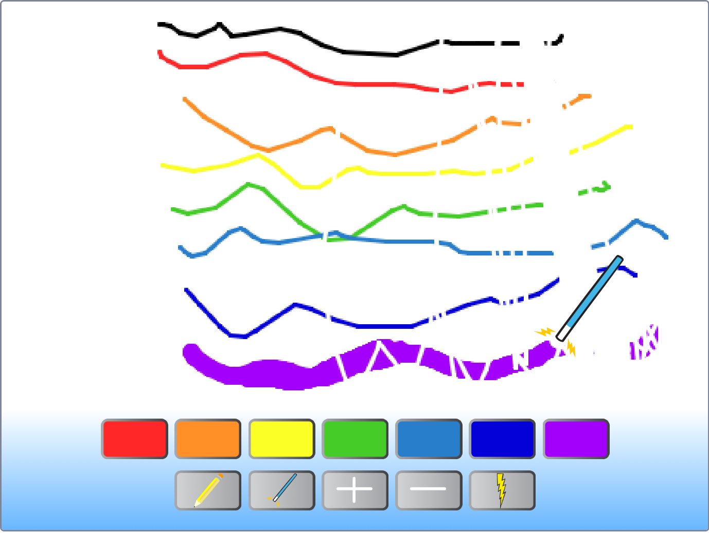

# Paint

> **Harvard CS50x – Week 0 (Scratch)**

Paint is a lightweight drawing application created in Scratch to explore user interaction and graphical programming concepts.

## Overview

Paint is a simple drawing application created in Scratch that allows users to draw using multiple colors.

The project demonstrates user interaction, drawing mechanics, and interface design.

---

## Usage

Users can freely draw on the stage by selecting colors and moving the cursor.

---

## Features

- Freehand drawing
- Multiple color selection
- Interactive interface
- Simple drawing canvas

---

## Controls

| Input | Action |
|--------|--------|
| Mouse | Draw and interact |

---

## Concepts Practiced

- User interaction
- Variables
- Event handling
- Interface design

---

## Technologies

- Scratch 3

---

## Course Information

**Course:** Harvard CS50x – Introduction to Computer Science

**Week:** Week 0 – Scratch

---

## Author

**Faizan Siddique**

[Back to Week 0](../README.md) · [Back to repository](../../README.md)
