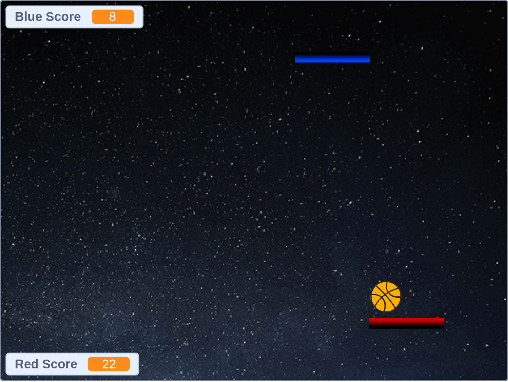

# Pong

> **Harvard CS50x – Week 0 (Scratch)**

Pong is a local two-player game developed as part of my Scratch practice for Harvard's CS50x Week 0.

## Overview

Pong is a Scratch implementation of the classic arcade game where players use paddles to keep the ball in play and score points.

This project emphasizes collision handling, player controls, and game state management.

---

## Gameplay

Pong is a local two-player game where each player controls a paddle to keep the ball in play. If a player misses the ball, the opposing player earns a point. The objective is to outscore your opponent by successfully returning the ball and preventing it from passing your paddle.

---

## Features

- Paddle controls
- Ball movement
- Collision detection
- Score tracking
- Classic Pong gameplay

---

## Controls

| Player | Controls |
|--------|----------|
| Top (Blue) Paddle | **A** = Left, **D** = Right |
| Bottom (Red) Paddle | **←** = Left, **→** = Right |

---

## Concepts Practiced

- Variables
- Collision detection
- Conditional logic
- Loops
- Animation

---

## Technologies

- Scratch 3

---

## Course Information

**Course:** Harvard CS50x – Introduction to Computer Science

**Week:** Week 0 – Scratch

---

## Author

**Faizan Siddique**

[Back to Week 0](../README.md) · [Back to repository](../../README.md)
