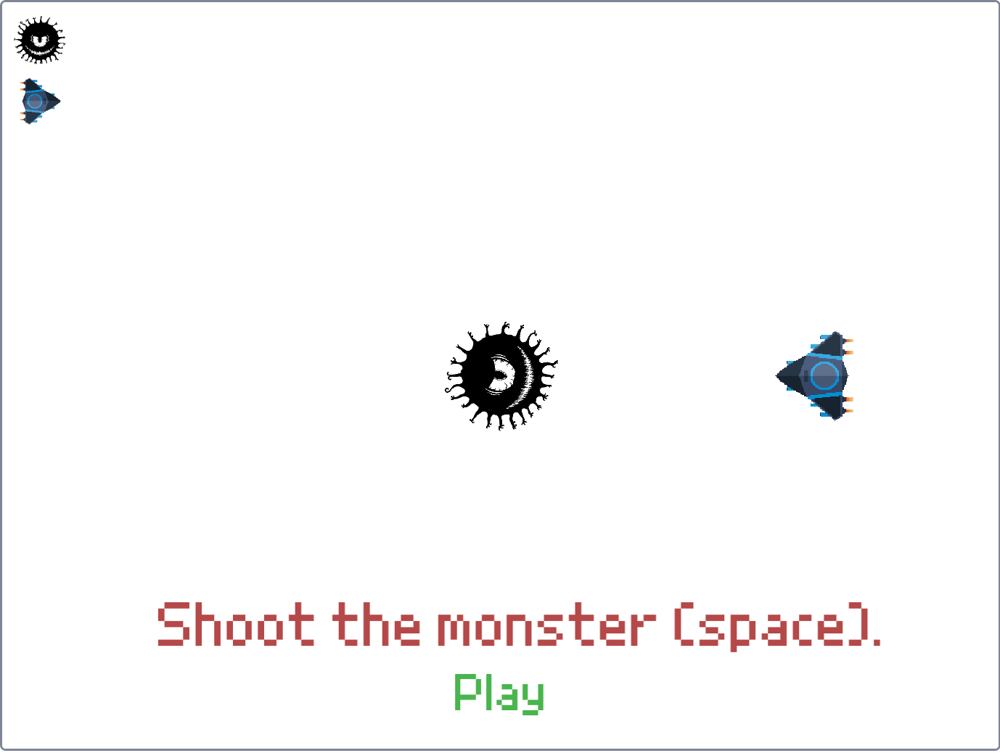
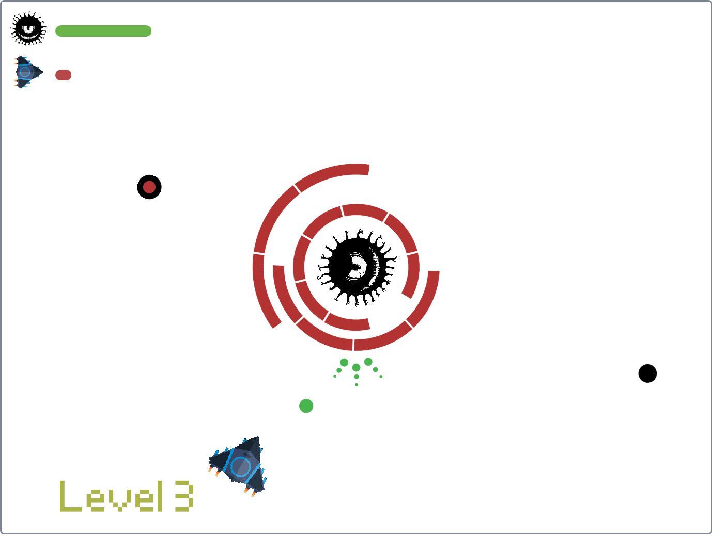
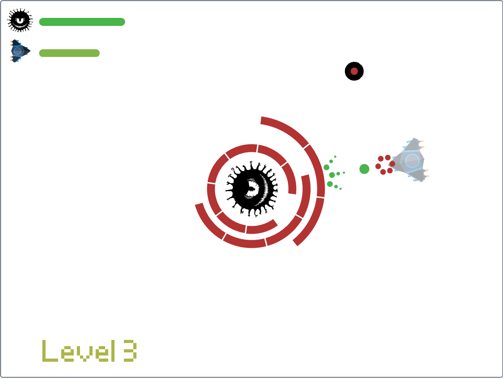
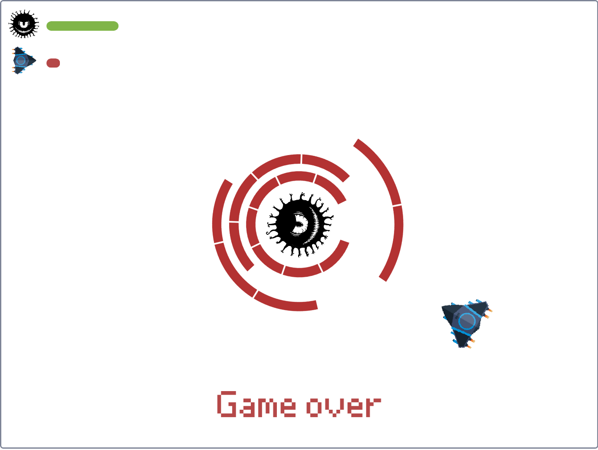
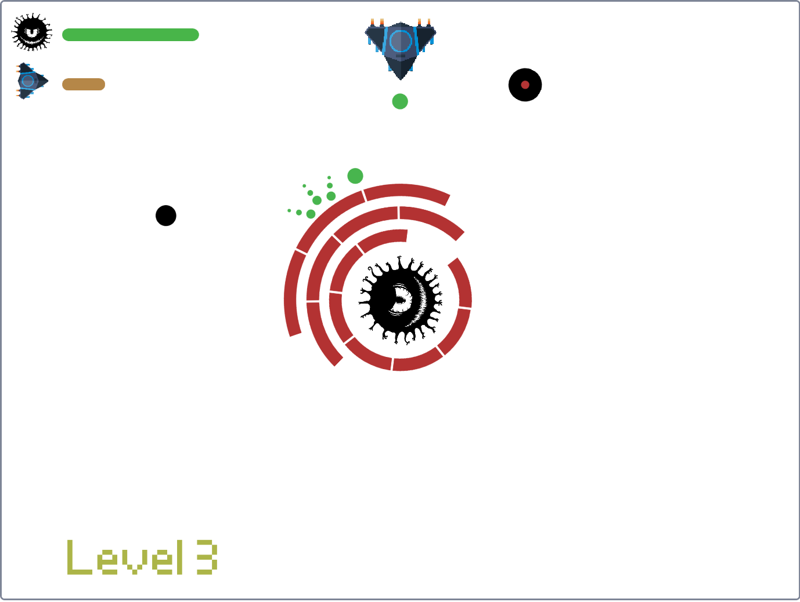
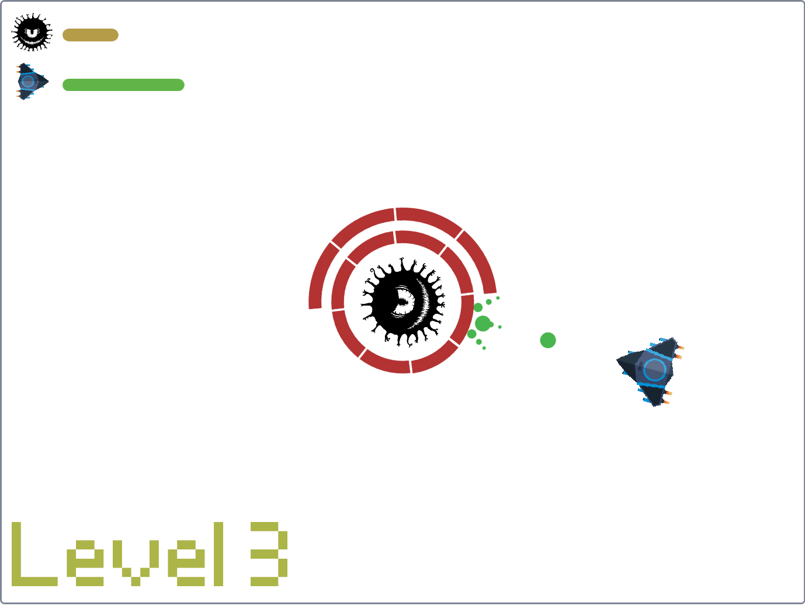
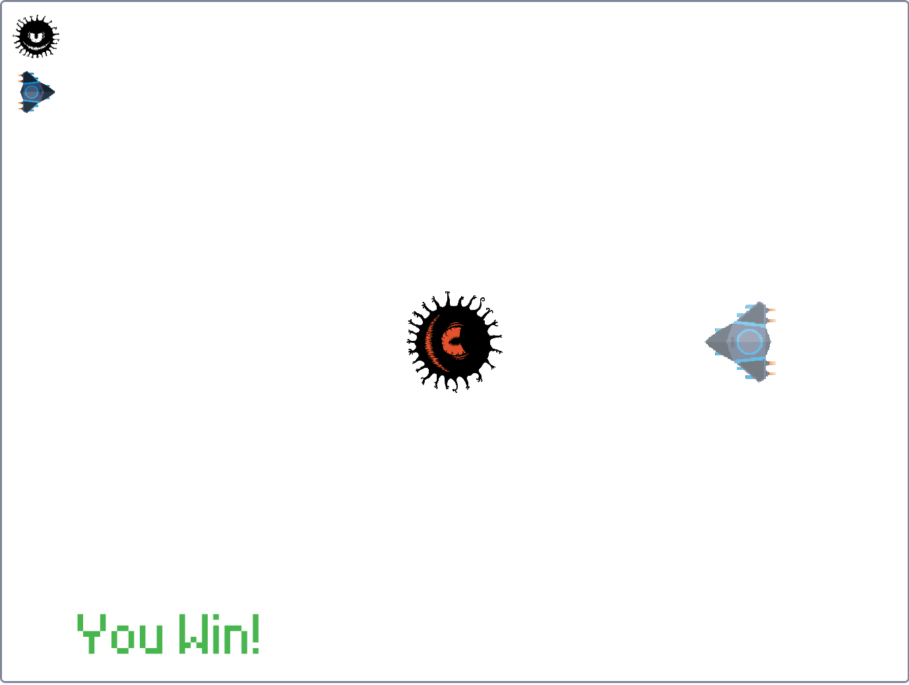
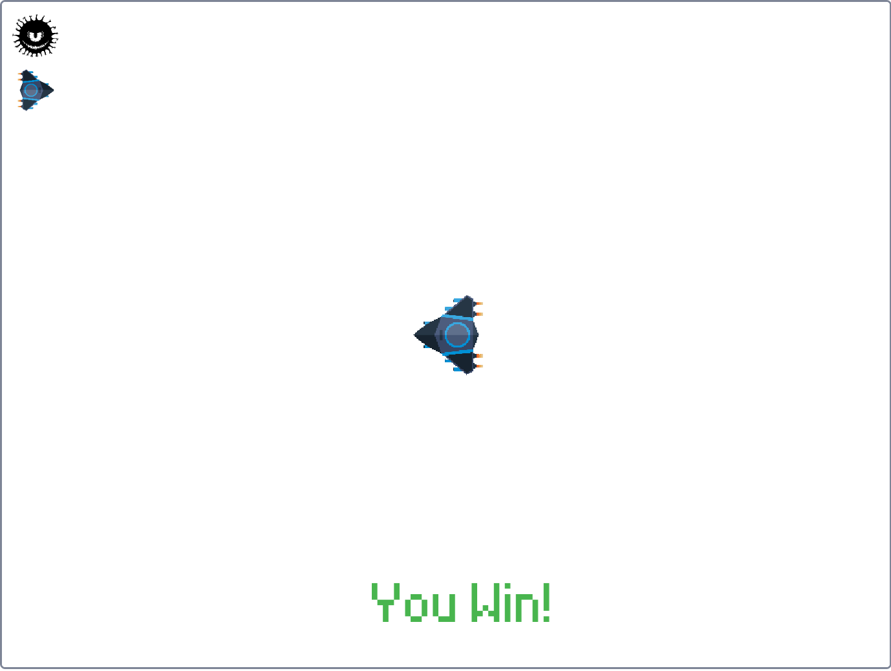

# Shoot the Monster

> **Harvard CS50x – Week 0 (Scratch)**

Shoot the Monster is an action game built during my Scratch exploration for Harvard's CS50x Week 0, emphasizing level progression and increasingly challenging gameplay.

## Overview

Shoot the Monster is an action game built in Scratch where the player defeats enemies while progressing through multiple levels.

The project focuses on player interaction, collision detection, level progression, and increasing game difficulty.

---

## Gameplay

Players eliminate enemies while avoiding failure conditions. The game becomes progressively more challenging through increasingly complex defensive layers surrounding the enemy in each level.

### Start Screen

### Gameplay

### Player Hit

### Game Over

### Gameplay

### Next Level

### Monster Defeated

### Victory

---

## Features

- Multiple levels
- Enemy interaction
- Collision detection
- Progressive difficulty
- Score and game progression

---

## Controls

| Key | Action |
|------|--------|
| ← | Rotate Left |
| → | Rotate Right |
| Space | Shoot |

---

## Concepts Practiced

- Event-driven programming
- Variables
- Broadcast messages
- Collision detection
- Level management

---

## Technologies

- Scratch 3

---

## Course Information

**Course:** Harvard CS50x – Introduction to Computer Science

**Week:** Week 0 – Scratch

---

## Author

**Faizan Siddique**

[Back to Week 0](../README.md) · [Back to repository](../../README.md)
