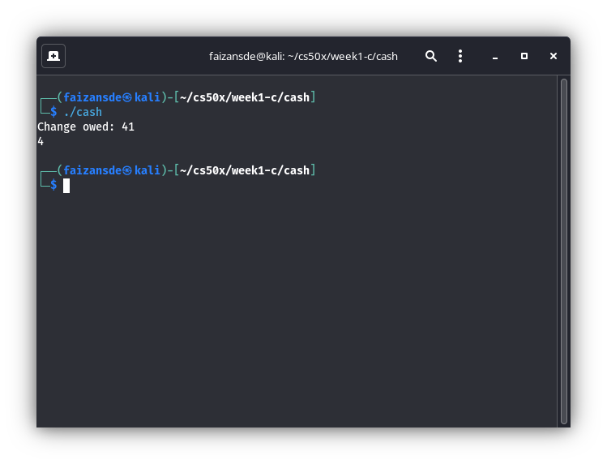

# Cash

> **Harvard CS50x – Week 1 (C)**

Cash is a C program that calculates the minimum number of coins required to provide a given amount of change.

---

## Overview

This project introduces the greedy algorithm by solving the classic coin-change problem.

The program prompts the user for an amount of change in cents and determines the fewest number of U.S. coins needed using quarters, dimes, nickels, and pennies.

---

## Example Output

---

## Features

- Accepts an amount of change in cents
- Rejects negative and invalid input
- Calculates the minimum number of coins
- Uses quarters, dimes, nickels, and pennies

---

## How It Works

The program uses a greedy strategy to minimize the number of coins for the supported U.S. denominations. This exercise connects input validation, integer arithmetic, and algorithmic reasoning.

---

## Concepts Practiced

- Greedy algorithms
- Calling library functions
- Integer arithmetic
- Conditional logic
- Input validation
- User input with `get_int()`
- Problem decomposition

---

## Technologies

- C
- CS50 Library
- GCC / Clang
- Terminal

---

## Course Information

- **Course:** Harvard CS50x – Introduction to Computer Science
- **Week:** 1 – C
- **Problem:** Cash
- **Verification:** Passed `check50` and `style50`, then submitted successfully

---

## Author

**Faizan Siddique**

[Back to Week 1](../README.md) · [Back to repository](../../README.md)
