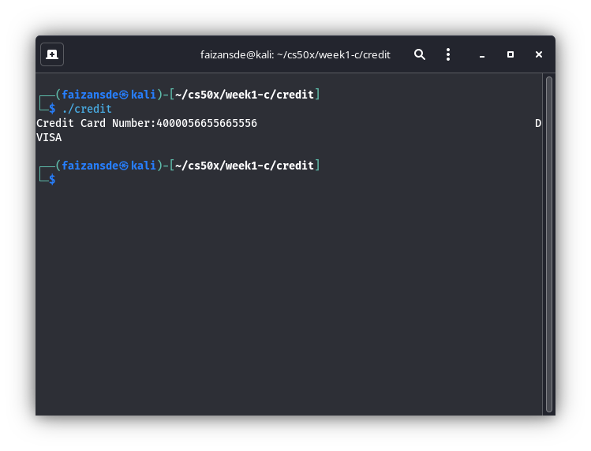

# Credit

> **Harvard CS50x – Week 1 (C)**

Credit is a C program that validates credit card numbers using Luhn's algorithm and identifies supported card types based on their number structure.

---

## Overview

This project combines checksum validation with card-number length and prefix rules to determine whether a credit card number is valid and whether it belongs to American Express, MasterCard, or Visa.

The program first applies Luhn's algorithm to verify the checksum and then evaluates the identifying digits and length of the number to classify the card.

---

## Example Output

---

## Features

- Accepts a credit card number from the user
- Validates the number using Luhn's algorithm
- Checks card-number length and identifying digits
- Identifies American Express, MasterCard, and Visa
- Rejects numbers with invalid checksums, lengths, or identifying digits

---

## How It Works

The program applies Luhn's checksum algorithm to the card number. If the checksum is valid, it examines the number's length and starting digits to determine the appropriate card type. Numbers that fail these validation rules are classified as invalid.

---

## Concepts Practiced

- Luhn's algorithm
- Integer arithmetic
- Loops
- Conditional logic
- Calling library functions
- Input validation
- Modulo operations
- Algorithmic problem-solving

---

## Technologies

- C
- CS50 Library
- GCC / Clang
- Terminal

---

## Course Information

- **Course:** Harvard CS50x – Introduction to Computer Science
- **Week:** 1 – C
- **Problem:** Credit
- **Verification:** Passed `check50` and `style50`, then submitted successfully

---

## Author

**Faizan Siddique**

[Back to Week 1](../README.md) · [Back to repository](../../README.md)
