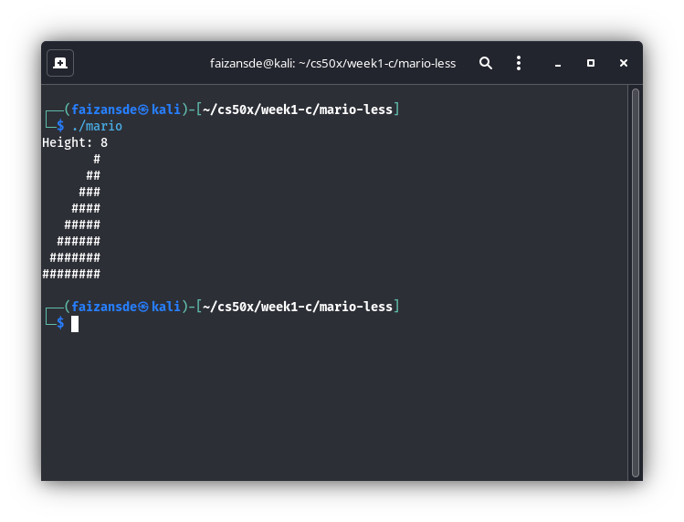

# Mario (Less)

> **Harvard CS50x – Week 1 (C)**

Mario (Less) is a C program that generates a right-aligned pyramid of blocks based on a height provided by the user.

---

## Overview

This project introduces nested loops and input validation by recreating one side of the pyramids from Nintendo's Super Mario games.

The program repeatedly prompts the user for a positive integer height, then constructs a right-aligned pyramid using spaces and `#` characters.

---

## Example Output

---

## Features

- Accepts a user-defined pyramid height
- Validates that the height is a positive integer
- Generates a right-aligned pyramid
- Dynamically calculates spaces and blocks for each row

---

## Concepts Practiced

- Loops
- Nested loops
- Conditional logic
- Input validation
- User input with `get_int()`
- Pattern generation
- Algorithmic problem-solving

---

## Technologies

- C
- CS50 Library
- GCC / Clang
- Terminal

---

## Course Information

- **Course:** Harvard CS50x – Introduction to Computer Science
- **Week:** 1 – C
- **Problem:** Mario (Less Comfortable)
- **Verification:** Passed `check50` and `style50`, then submitted successfully

---

## Author

**Faizan Siddique**

[Back to Week 1](../README.md) · [Back to repository](../../README.md)
