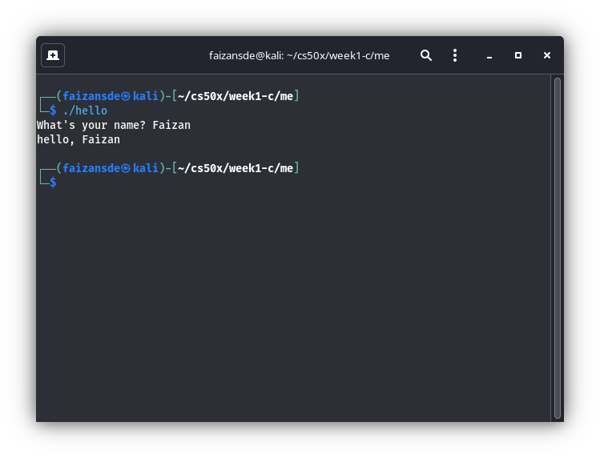

# Me

> **Harvard CS50x – Week 1 (C)**

Me is an interactive C program that prompts the user for their name and prints a personalized greeting.

---

## Overview

This project builds upon the basic `Hello, World` program by introducing user input through the CS50 Library.

The interaction demonstrates text input and a personalized response in the terminal.

---

## Example Output

---

## Features

- Prompts the user for their name
- Stores text input in a string variable
- Produces personalized formatted output

---

## Concepts Practiced

- Including header files
- Using the CS50 Library
- Declaring and using string variables
- Reading user input with `get_string()`
- Formatting output with `printf()`
- Compiling and linking an external C library

---

## Technologies

- C
- CS50 Library
- GCC / Clang
- Terminal

---

## Course Information

- **Course:** Harvard CS50x – Introduction to Computer Science
- **Week:** 1 – C
- **Problem:** Me
- **Verification:** Passed `check50` and `style50`, then submitted successfully

---

## Author

**Faizan Siddique**

[Back to Week 1](../README.md) · [Back to repository](../../README.md)
