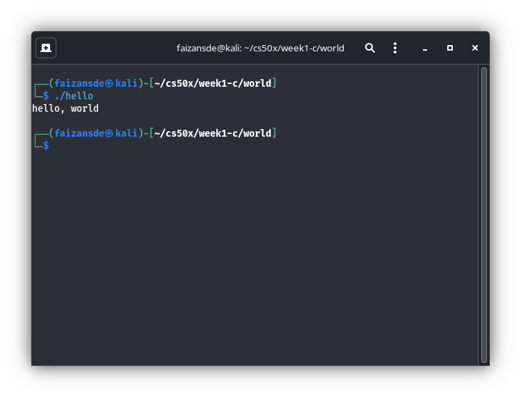

# World

> **Harvard CS50x – Week 1 (C)**

World is the introductory program for Harvard's CS50x Week 1. It demonstrates the basic structure of a C program by printing a simple greeting to the terminal.

---

## Overview

This project introduces compiling and running C programs using the CS50 development environment. It serves as the first step in transitioning from Scratch to text-based programming.

---

## Output

---

## Concepts Practiced

- Writing a basic C program
- Using the `main` function
- Calling `printf()`
- Compiling programs with `make`
- Running executables from the terminal

---

## Technologies

- C
- Standard C Library
- GCC / Clang
- Terminal

---

## Course Information

- **Course:** Harvard CS50x – Introduction to Computer Science
- **Week:** 1 – C
- **Problem:** World
- **Verification:** Compiled and tested successfully; no `check50` or submission was required

---

## Author

**Faizan Siddique**

[Back to Week 1](../README.md) · [Back to repository](../../README.md)
