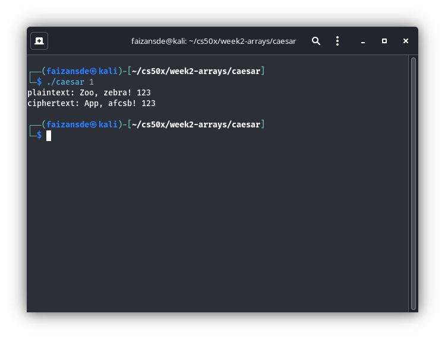

# Caesar

> **Harvard CS50x – Week 2 (Arrays)**

Caesar encrypts text by shifting letters through the alphabet using a numeric command-line key.

---

## Overview

Run the program with one nonnegative decimal key argument, then enter text at `plaintext:`. Alphabetic characters rotate with wraparound, preserving uppercase or lowercase. Other characters are printed unchanged.

## Example Output

Representative output from the private coursework repository is shown below, with inputs alongside their prompts.

```text
$ ./caesar 1
plaintext: Zoo, zebra! 123
ciphertext: App, afcsb! 123
```



---

## Features

- Requires exactly one key argument and rejects characters outside `0`–`9`
- Prints `Usage: ./caesar key` and returns status 1 for rejected arguments
- Reduces the rotation count modulo 26
- Preserves spaces, punctuation, and digits in the plaintext
- A key of zero leaves the plaintext unchanged

## How It Works

A numeric key controls a cyclic alphabetic shift. The exercise combines command-line validation, modular arithmetic, and preserving the formatting of text during transformation.

## Concepts Practiced

- Command-line arguments with `argc` and `argv`
- Boolean validation and helper functions
- Decimal conversion and modulo arithmetic
- String traversal with `strlen()` and character checks with `isalpha()`
- Input with `get_string()` and output with `printf()`

---

## Technologies

- C and the standard C library
- CS50 Library
- C compiler and terminal

## Verification

**CS50 verification:** Compiled successfully, passed all applicable `check50` checks, completed `style50` and `design50` successfully, and submitted to CS50.

**Local verification:** Compiled and ran successfully in the private coursework repository; the representative output is shown above.

**Source availability:** Assessment source code is kept private in accordance with [CS50’s Academic Honesty policy](https://cs50.harvard.edu/x/honesty/?utm_source=chatgpt.com).

---

[Back to Week 2](../README.md) · [Back to repository](../../README.md)
