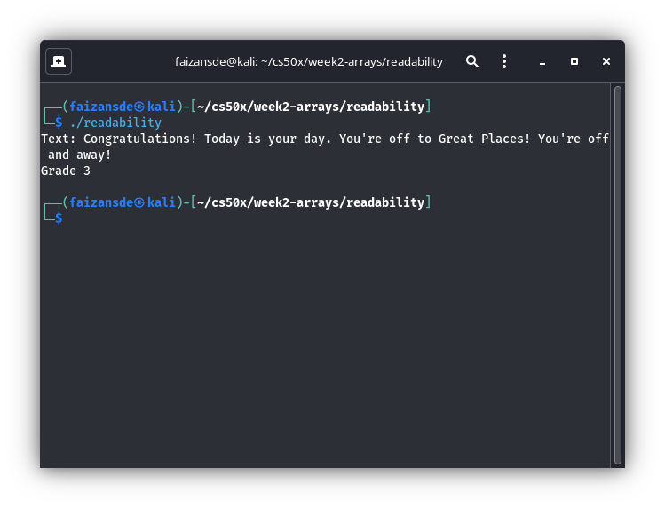

# Readability

> **Harvard CS50x – Week 2 (Arrays)**

Readability estimates the U.S. grade level needed to read a text using the Coleman–Liau index.

---

## Overview

The program prompts for `Text:` and counts letters, words, and sentence-ending punctuation. These measurements feed the Coleman–Liau index to estimate a reading grade level.

## Example Output

Representative output from the private coursework repository is shown below, with inputs alongside their prompts.

```text
$ ./readability
Text: Congratulations! Today is your day. You're off to Great Places! You're off and away!
Grade 3
```



---

## Features

- Prints `Grade 1` through `Grade 15`, `Before Grade 1`, or `Grade 16+`
- Measures alphabetic characters, words, and sentence-ending punctuation
- Uses a custom rounding helper for the grade estimate

## How It Works

The estimate connects text statistics with a numerical reading-level model. Separate counting and rounding responsibilities demonstrate helper functions and the distinction between integer counts and floating-point calculations. The result is a grade estimate rather than a full linguistic assessment.

## Concepts Practiced

- Separate helper functions for text counts and rounding
- String traversal with `strlen()`
- Character classification with `isalpha()`
- Integer counts, floating-point arithmetic, and casting
- Input with `get_string()` and output with `printf()`

---

## Technologies

- C and the standard C library
- CS50 Library
- C compiler and terminal

## Verification

**CS50 verification:** Compiled successfully, passed all applicable `check50` checks, completed `style50` and `design50` successfully, and submitted to CS50.

**Local verification:** Compiled and ran successfully in the private coursework repository; the representative output is shown above.

---

[Back to Week 2](../README.md) · [Back to repository](../../README.md)
