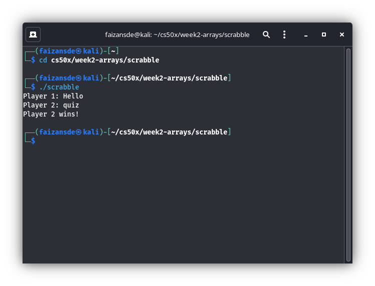

# Scrabble

> **Harvard CS50x – Week 2 (Arrays)**

Scrabble compares the letter scores of two player inputs and prints the winner or a tie.

---

## Overview

The program prompts for `Player 1:` and `Player 2:` text. It scores letters without regard to case, ignores non-letter characters, and compares the two totals. It does not check whether an input is a dictionary word.

## Example Output

Representative output from the private coursework repository is shown below, with inputs alongside their prompts.

```text
$ ./scrabble
Player 1: Hello
Player 2: quiz
Player 2 wins!
```



---

## Features

- Uses a 26-element array of letter scores
- Treats uppercase and lowercase letters equally
- Ignores spaces, punctuation, and digits when scoring
- Prints `Player 1 wins!`, `Player 2 wins!`, or `Tie!`; it does not print numeric scores
- An empty input scores zero

## How It Works

The scoring task connects character processing with an indexed table of letter values. Case-insensitive comparison lets both players use mixed-case text, while the result communicates the higher score or a tie.

## Concepts Practiced

- Array lookup and character indexing
- Helper functions with return values
- String traversal with `strlen()`
- Character classification and case conversion
- Input with `get_string()` and output with `printf()`

---

## Technologies

- C and the standard C library
- CS50 Library
- C compiler and terminal

## Verification

**CS50 verification:** Compiled successfully, passed all applicable `check50` checks, completed `style50` and `design50` successfully, and submitted to CS50.

**Local verification:** Compiled and ran successfully in the private coursework repository; the representative output is shown above.

**Source availability:** Assessment source code is kept private in accordance with [CS50’s Academic Honesty policy](https://cs50.harvard.edu/x/honesty/?utm_source=chatgpt.com).

---

[Back to Week 2](../README.md) · [Back to repository](../../README.md)
