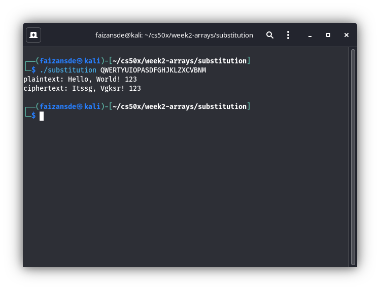

# Substitution

> **Harvard CS50x – Week 2 (Arrays)**

Substitution encrypts text using a command-line key that supplies a replacement for each letter of the alphabet.

---

## Overview

Provide a 26-letter key containing each English letter once, in any order and case. Its first character replaces `A`, its second replaces `B`, and so on. After validating the key, the program prompts for `plaintext:` and prints `ciphertext:`.

## Example Output

Representative output from the private coursework repository is shown below, with inputs alongside their prompts.

```text
$ ./substitution QWERTYUIOPASDFGHJKLZXCVBNM
plaintext: Hello, World! 123
ciphertext: Itssg, Vgksr! 123
```



---

## Features

- Requires exactly one key argument
- Rejects keys that are not 26 characters long or contain non-letter characters
- Rejects repeated letters without regard to case
- Preserves the uppercase or lowercase form of each plaintext letter
- Passes spaces, punctuation, and digits through unchanged

## How It Works

The key defines a one-to-one alphabetic mapping. Validation checks its length, letter content, and uniqueness before encryption. Case-insensitive duplicate detection and case-preserving output bring together arrays, character processing, and input validation.

## Concepts Practiced

- Command-line validation and Boolean helper functions
- Arrays for duplicate detection and indexed substitution
- String length and traversal with `strlen()`
- Character classification and case conversion
- Input with `get_string()` and output with `printf()`

---

## Technologies

- C and the standard C library
- CS50 Library
- C compiler and terminal

## Verification

**CS50 verification:** Compiled successfully, passed all applicable `check50` checks, completed `style50` and `design50` successfully, and submitted to CS50.

**Local verification:** Compiled and ran successfully in the private coursework repository; the representative output is shown above.

**Source availability:** Assessment source code is kept private in accordance with [CS50’s Academic Honesty policy](https://cs50.harvard.edu/x/honesty/?utm_source=chatgpt.com).

---

[Back to Week 2](../README.md) · [Back to repository](../../README.md)
