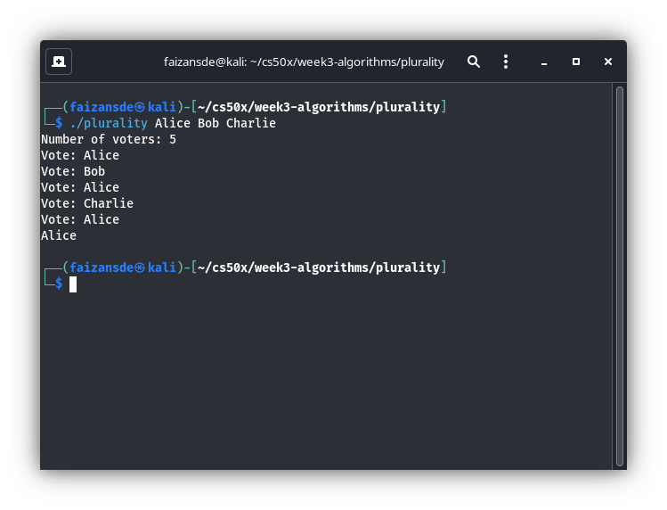

# Plurality

> **Harvard CS50x – Week 3 (Algorithms)**

Plurality models an election in which each voter selects one candidate and the candidate or candidates with the most votes win.

---

## Overview

The problem represents candidates and their vote totals with arrays, accepts voter choices as strings, and compares those choices with the candidate names. The implementation separates responsibilities across functions: record a valid vote, determine the greatest vote total, and print every candidate tied at that total.

## Example Evidence

## Concepts Practiced

- Candidate records and arrays
- Strings and matching a voter's choice to a candidate
- Function responsibilities for recording, tallying, and reporting results
- Handling ties when multiple candidates share the highest count

## Verification

- **Course status (author-confirmed):** Passed all 13 `check50` checks.

---

[Back to Week 3](../README.md) · [Back to repository](../../README.md)
