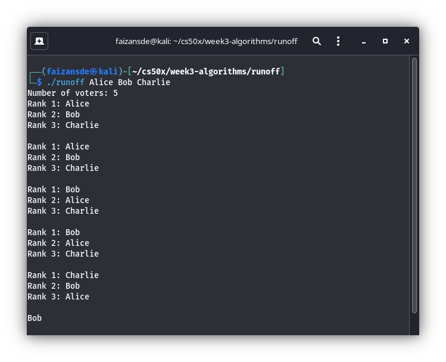

# Runoff

> **Harvard CS50x – Week 3 (Algorithms)**

Runoff simulates ranked-choice voting, where voters rank candidates and ballots move to the next preferred candidate still in the election as lower candidates are eliminated.

---

## Overview

Each ballot stores a ranked sequence of candidate choices. In each round, the tabulation counts each ballot for its highest-ranked active candidate. A candidate with a majority wins; otherwise the lowest candidate or tied lowest candidates are eliminated, and the next round recounts ballots using the updated active-candidate state.

This process practices the interaction between ballot rankings, vote counting, candidate status, elimination, and vote transfers across rounds.

## Example Evidence

## Concepts Practiced

- Storing ranked choices in arrays
- Counting a ballot for the highest-ranked candidate still active
- Tracking active candidates between rounds
- Detecting a majority and ties
- Eliminating the lowest-ranked candidates and transferring votes in the next tabulation

## Verification

- **Course status (author-confirmed):** Passed all 25 `check50` checks; `style50` reported “Looks good!”.

---

[Back to Week 3](../README.md) · [Back to repository](../../README.md)
