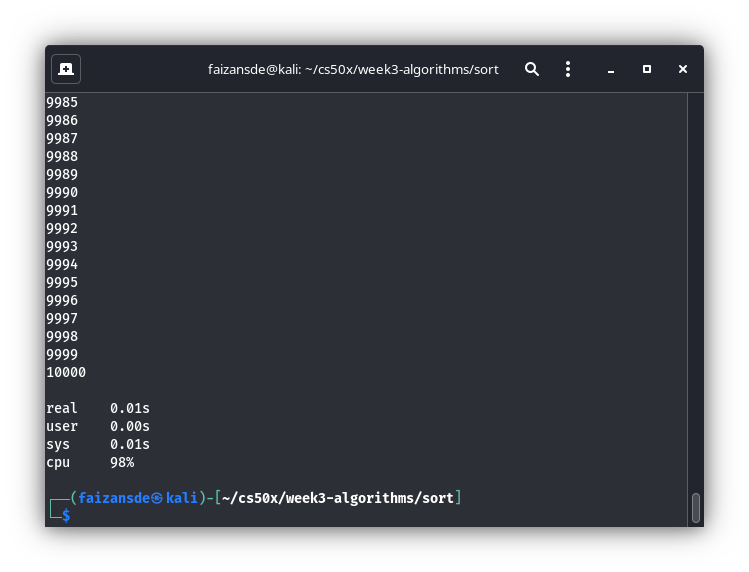
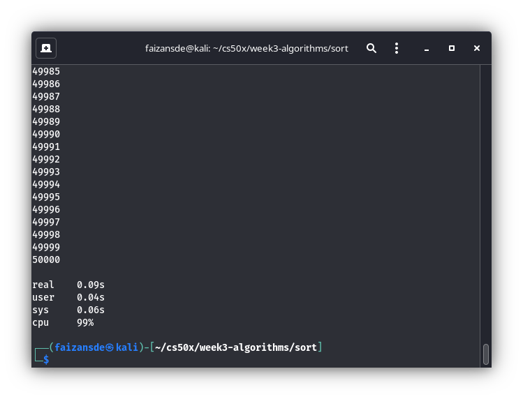
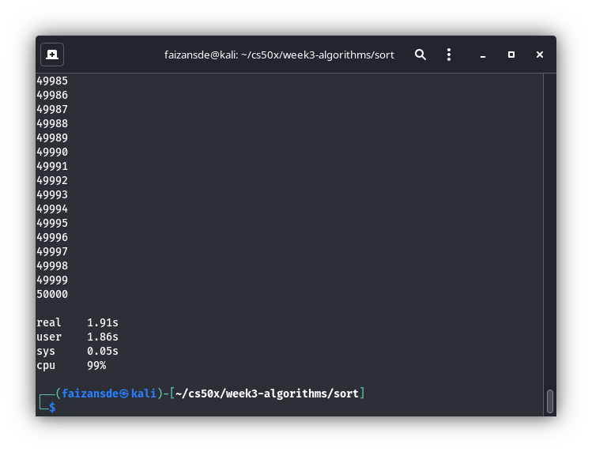
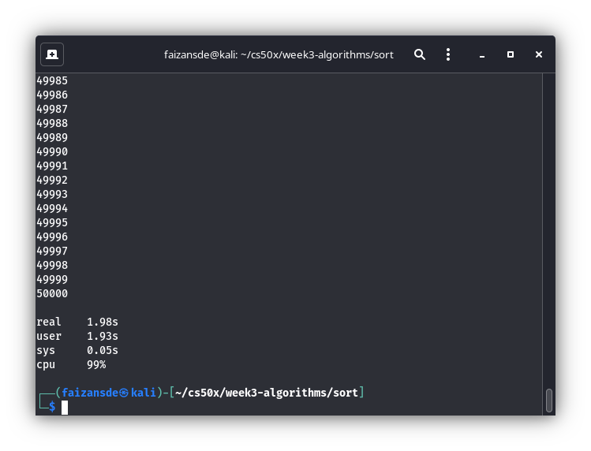

# Sort

> **Harvard CS50x – Week 3 (Algorithms)**

This assignment compares three sorting algorithms by measuring their run times on inputs of different sizes and orders.

---

## Overview

The experiments use Bubble sort, Merge sort, and Selection sort with sorted, reversed, and randomized data. Observing each algorithm on the same kinds of input helps connect measured behavior to algorithmic complexity and to the work an algorithm must do as the input grows.

## Timing Comparisons

The screenshots below preserve the terminal evidence from the experiments. They show selected 10,000- and 50,000-item inputs; timing results are observations from those runs, not fixed performance guarantees. Input order matters: a sorted input can change the work performed by an algorithm that detects when a pass makes no swaps, while reversed and randomized inputs exercise different patterns. Growth in input size also makes the algorithms' different scaling behavior easier to observe.

| Algorithm | Input | User CPU time (seconds) |
|-----------|-------|------------------------:|
| Bubble sort | Reversed, 10,000 items | 0.176 |
| Bubble sort | Reversed, 50,000 items | 4.314 |
| Bubble sort | Sorted, 50,000 items | 0.048 |
| Merge sort | Reversed, 10,000 items | 0.011 |
| Merge sort | Reversed, 50,000 items | 0.052 |
| Merge sort | Sorted, 50,000 items | 0.049 |
| Merge sort | Random, 50,000 items | 0.056 |
| Selection sort | Reversed, 10,000 items | 0.083 |
| Selection sort | Reversed, 50,000 items | 2.011 |

These are the user CPU times reported in the private `answers.txt`; timings can vary across runs and machines.

### Bubble sort

### Merge sort

### Selection sort

## Concepts Practiced

- Comparing Bubble sort, Merge sort, and Selection sort
- Relating observed timing to algorithmic complexity
- Considering input size, sortedness, and order when interpreting a timing result
- Treating experimental measurements as evidence about a run rather than a universal ranking

## Verification

- **Course status (author-confirmed):** All `check50` checks passed.
- Screenshots document the timing experiments; no additional program runs were performed for this portfolio page.

---

[Back to Week 3](../README.md) · [Back to repository](../../README.md)
