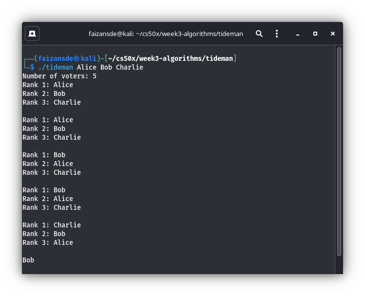

# Tideman

> **Harvard CS50x – Week 3 (Algorithms)**

Tideman, also known as ranked pairs, uses voters' rankings to create pairwise preferences, orders the winning pairs by victory strength, and locks those pairs into a directed graph without creating a cycle.

---

## Overview

The project moves from ranked ballots to pairwise comparisons. Each pairwise result identifies a winner and a loser; winning pairs are then considered in strength order. Locking an edge records a stronger preference while preserving a graph that can still express a consistent ordering of candidates.

## The Problem-Solving Challenge

Tideman was the optional challenge in Problem Set 3, and I chose to take it on. When I started, the problem initially seemed manageable. The hard part emerged at `lock_pairs()` and its recursive helper, `can_reach()`: before adding a directed edge from a winner to a loser, the implementation has to determine whether the loser can already reach the winner through a path of locked edges.

That question is about reachability, not just whether the two candidates have a direct edge. The recursive search must follow paths through the graph, and the proposed edge must be rejected if it would close a path back to its starting point and create a cycle. I spent two days understanding and correctly implementing that cycle-prevention logic. Sort, Plurality, and Runoff felt comparatively straightforward to me; Tideman required tracing how recursion explores existing paths and how each accepted edge changes what later paths can reach.

I eventually completed it, passed all 17 `check50` checks, received no `style50` warnings, and submitted the challenge. That persistence through graph paths, recursion, and cycle prevention was the defining technical achievement of my Week 3 work.

## Example Evidence

## Concepts Practiced

- Pairwise voter preferences
- Winning pairs and victory strength
- Representing locked pairs as directed graph edges
- Recursive graph traversal and reachability
- Testing whether adding an edge would create a cycle

## Verification

- **Course status (author-confirmed):** Passed all 17 `check50` checks, received no `style50` warnings, and submitted.

---

[Back to Week 3](../README.md) · [Back to repository](../../README.md)
